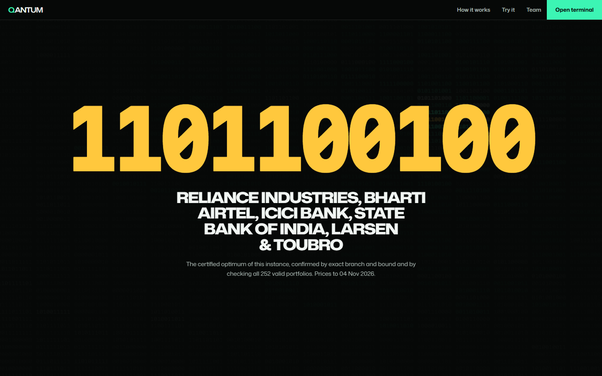
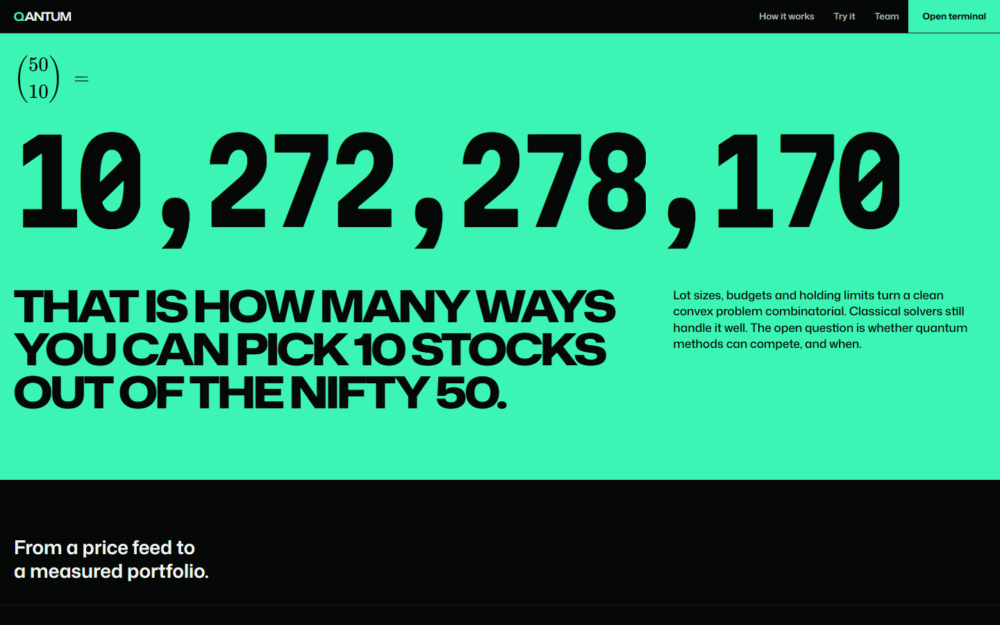
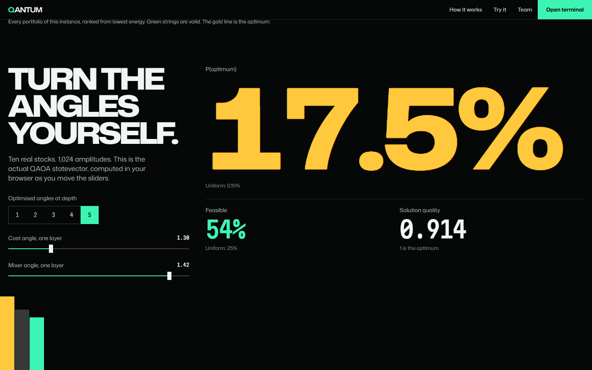
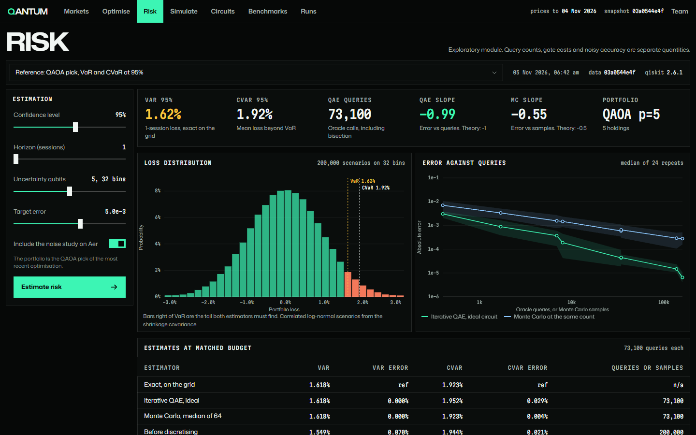
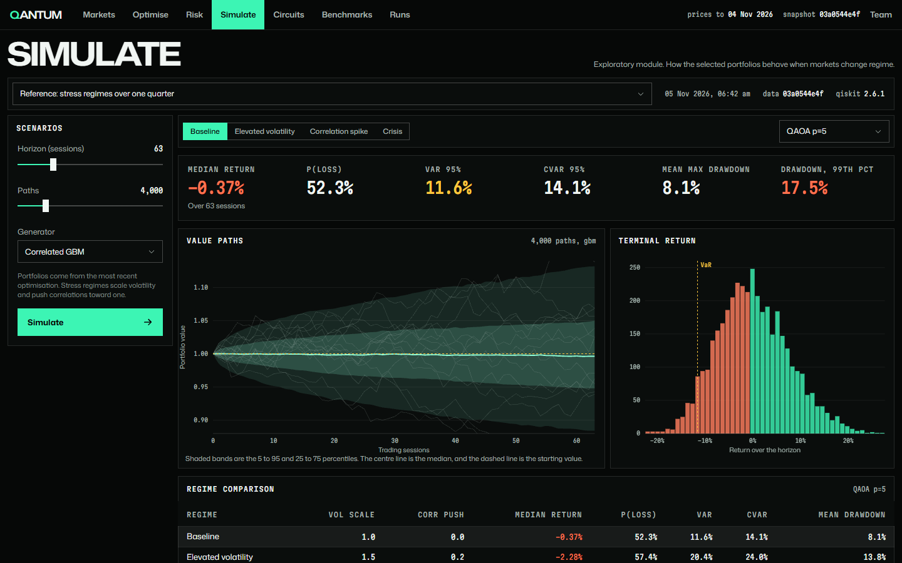
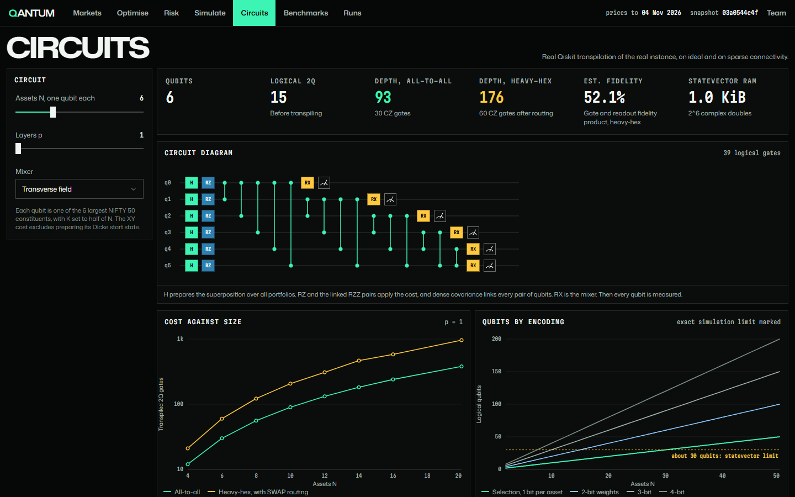
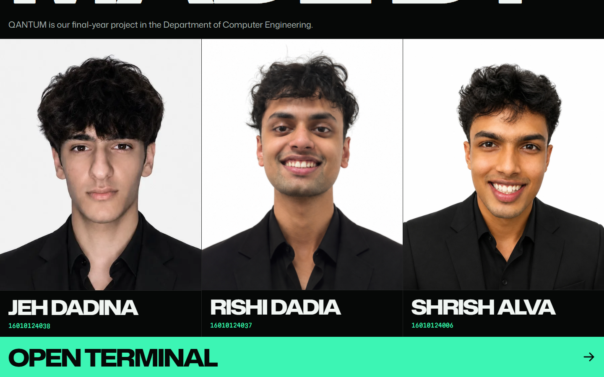

<div align="center">

# QANTUM

**Ten billion portfolios. One measurement.**

We pitted quantum algorithms against classical solvers on real NIFTY 50 data to see who actually wins.


</div>

## What is this

Pick 10 stocks out of the NIFTY 50 and you have 10,272,278,170 possible portfolios. Add real rules like holding limits and budgets, and it stops being a clean maths problem.

QANTUM is our final-year project. It runs QAOA and Quantum Amplitude Estimation next to exact and heuristic classical solvers, on the same data with the same budget, and saves every run so anyone can reproduce it.

We don't claim quantum advantage. When quantum loses, we report it.





## Try the circuit yourself

The landing page runs a real 10-qubit QAOA statevector in your browser. Move the angles and watch the probability pile up on the best portfolio.



## The terminal

Seven workspaces. Press keys `1` to `7` to jump between them.

**Optimise:** QAOA vs exact MIQP vs simulated annealing vs brute force, on one instance.


**Markets:** all 50 stocks, cleaned, hashed and versioned.


**Risk:** VaR and CVaR with Iterative QAE vs Monte Carlo.



**Simulate:** correlated market paths and stress regimes, crisis included.



**Circuits:** real transpiled circuits, and what they cost on sparse hardware.



**Benchmarks:** matched budgets, walk-forward backtests and Wilcoxon tests.


**Runs:** every experiment, with its seed, data hash and library versions.

## Run it

You need Python 3.12 and Node 20 or newer.

```powershell
.\start.ps1
```

```bash
./start.sh
```

Then open <http://127.0.0.1:8000>. The script sets everything up the first time. On a fresh install, reference experiments fill the terminal in the background over a few minutes.

There's no login, so only run it on a machine you trust.

Tests:

```bash
cd backend && .venv/Scripts/python -m pytest tests -q
```

## Built with

Qiskit and Aer, NumPy, SciPy, scikit-learn, FastAPI, SQLAlchemy, React, TypeScript, Vite, Tailwind and D3.

## Being honest

- Everything so far ran on simulators. The IBM hardware path exists but has never been run.
- The noise model is an assumption and doesn't describe a real device.
- SQLite is the default. The PostgreSQL setup hasn't been run.
- The reference benchmark is the quick grid, which is too small for statistical conclusions.
- History uses today's index constituents, so survivorship bias is present.
- The 17.5% on the landing page uses angles picked knowing the answer. The terminal's reference run gets 6.79%.

## Made by



| | |
| --- | --- |
| Jeh Dadina | 16010124038 |
| Rishi Dadia | 16010124037 |
| Shrish Alva | 16010124006 |

Guide: Mr. Swapnil Pawar. Co-guide: Dr. Vaibhav Vasani.

Department of Computer Engineering.
