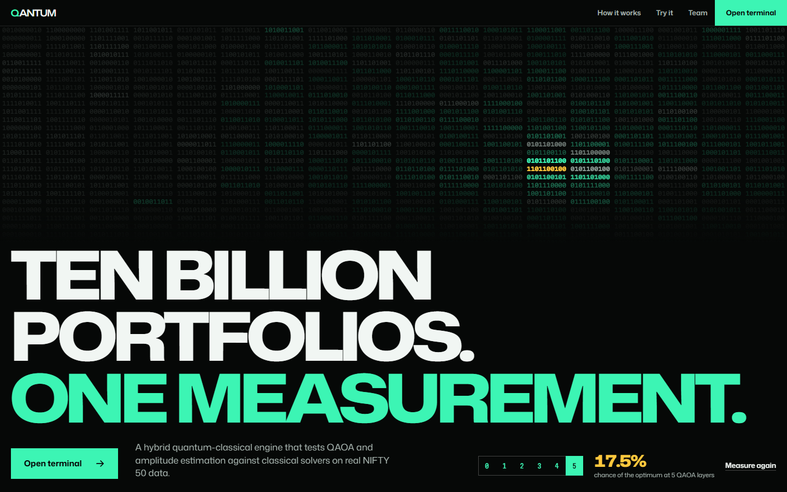
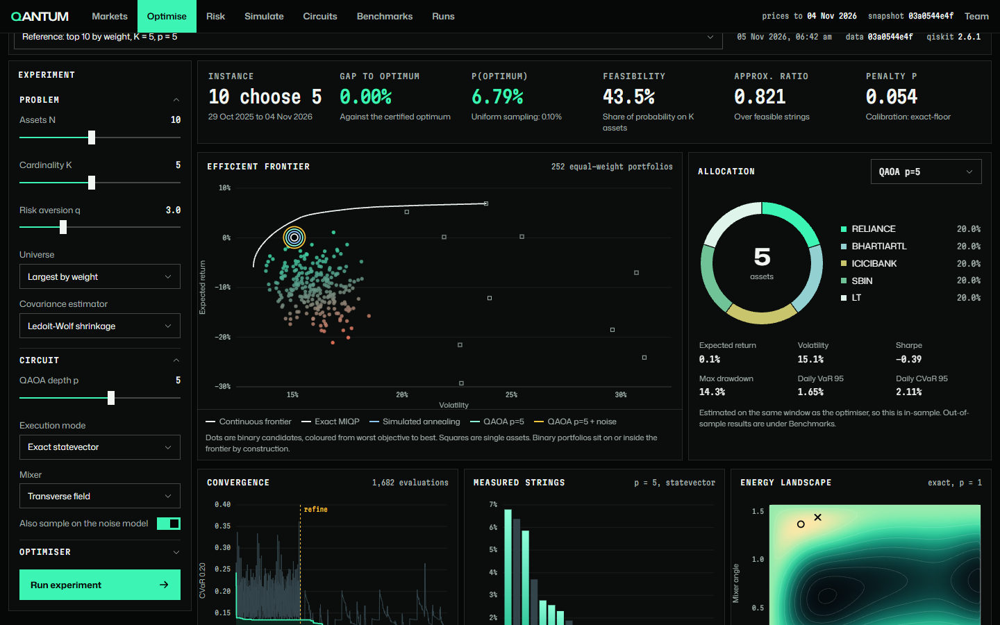
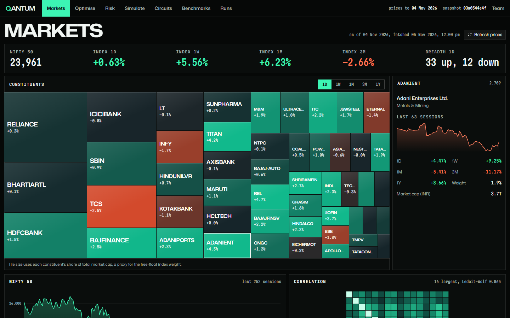
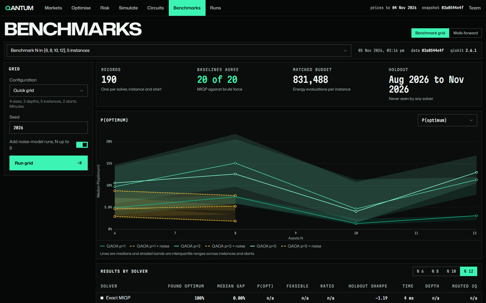

<div align="center">

# QANTUM

**Ten billion portfolios. One measurement.**

Quantum finance. QAOA and amplitude estimation vs classical solvers on real NIFTY 50 data.

**[Live demo](https://huggingface.co/spaces/jehdadina/qantum)**



</div>

## Screens







## Run it

You need Python 3.12 and Node 20 or newer.

```powershell
.\start.ps1
```

```bash
./start.sh
```

Then open <http://127.0.0.1:8000>.

## Good to know

Everything so far ran on simulators, not real quantum hardware. We make no claim of quantum advantage.

## Made by

Jeh Dadina, Rishi Dadia and Shrish Alva.

Guide: Mr. Swapnil Pawar. Co-guide: Dr. Vaibhav Vasani.
